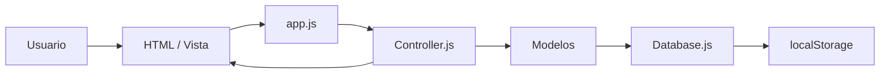

# SIVE – ElectroHogar | Fase III

**Sistema Integral de Inventario y Ventas de Electrodomésticos**

Universidad Don Bosco – Análisis y Diseño de Sistemas Informáticos (ADS)  
Proyecto académico | Noviembre de 2026

## Integrantes

| Nombre | Carné |
| --- | --- |
| CASTRO FUNES JOSÉ MARÍA | CF041138 |
| CHÁVEZ MOLINA PATRICIA MARIBEL | CM152479 |
| ORELLANA GUZMAN KARLA BEATRIZ | OG253196 |

## Contenido

1. [Descripción general](#descripción-general)
2. [Problema y justificación](#problema-y-justificación)
3. [Objetivos](#objetivos)
4. [Alcance y estado del proyecto](#alcance-y-estado-del-proyecto)
5. [Módulos y funcionamiento](#módulos-y-funcionamiento)
6. [Roles y permisos](#roles-y-permisos)
7. [Reglas de negocio y validaciones](#reglas-de-negocio-y-validaciones)
8. [Tecnologías y arquitectura](#tecnologías-y-arquitectura)
9. [Cómo ejecutar la aplicación](#cómo-ejecutar-la-aplicación)
10. [Modelo de datos y documentación de análisis](#modelo-de-datos-y-documentación-de-análisis)
11. [Casos de uso](#casos-de-uso)
12. [Evidencias de interfaz](#evidencias-de-interfaz)
13. [Pruebas funcionales](#pruebas-funcionales)
14. [Metodología Scrum y control de versiones](#metodología-scrum-y-control-de-versiones)
15. [Limitaciones y mejoras futuras](#limitaciones-y-mejoras-futuras)

## Descripción general

**SIVE–ElectroHogar** es una aplicación web académica orientada a la gestión comercial de ElectroHogar, una empresa ficticia dedicada a la venta de refrigeradoras, cocinas, lavadoras, televisores, microondas y otros electrodomésticos.

La Fase III amplía el prototipo desarrollado en la Fase II mediante una arquitectura Modelo–Vista–Controlador (MVC), programación orientada a objetos, formularios con validaciones, control de roles y una interfaz responsiva. Integra la gestión de productos, clientes, proveedores, usuarios, inventario, ventas, compras y reportes en una misma aplicación.

## Problema y justificación

El escenario de estudio plantea una empresa que utiliza registros manuales o archivos separados para administrar mercadería y ventas. Esto dificulta conocer las existencias actualizadas, evitar duplicidades y obtener información administrativa de manera oportuna.

SIVE propone organizar estas operaciones, automatizar los cálculos de ventas y compras, validar las cantidades disponibles y facilitar el seguimiento de los movimientos del inventario. El sistema busca mejorar la organización de la información y apoyar la toma de decisiones.

El escenario corresponde a una propuesta académica, no a resultados verificados de entrevistas o pruebas de campo en una empresa real.

## Objetivos

### Objetivo general

Desarrollar una aplicación web funcional de inventario y ventas para ElectroHogar, aplicando los requerimientos y modelos definidos en las fases anteriores, mediante la arquitectura MVC y la programación orientada a objetos.

### Objetivos específicos

- Implementar los módulos comerciales y administrativos definidos en el análisis del sistema.
- Aplicar reglas de negocio y validaciones para reducir errores de captura y procesamiento de datos.
- Automatizar el registro de ventas, compras y movimientos de inventario.
- Incorporar autenticación de demostración y permisos diferenciados por rol.
- Diseñar una interfaz amigable y adaptable a diferentes dispositivos.
- Facilitar la consulta de información mediante indicadores, reportes y exportaciones.
- Utilizar Git, GitHub y la metodología Scrum para organizar el desarrollo colaborativo.

## Alcance y estado del proyecto

| Área | Fase II | Fase III |
| --- | --- | --- |
| Panel de control | Indicadores básicos | Indicadores de productos, existencias, ventas, compras y stock bajo |
| Productos | Registro y listado | Registro, búsqueda, edición y cambio de estado |
| Inventario | Entradas y salidas | Motivos preestablecidos, opción personalizada e historial con usuario responsable |
| Ventas | Un producto por operación | Múltiples productos, subtotales, retiro de detalles y confirmación |
| Compras | Pendiente | Registro de compras y actualización automática de existencias |
| Clientes y proveedores | Pendiente | Registro, edición, activación y desactivación |
| Usuarios y roles | Pendiente | Inicio de sesión, registro, edición, cambio de rol y estado, en el navegador |
| Reportes | Básico | Filtros por fechas, totales, CSV e impresión/PDF |
| Persistencia | localStorage | localStorage y exportación de respaldo JSON |
| Base relacional integrada | Pendiente | Pendiente; SQLite permanece como diseño independiente |

## Módulos y funcionamiento

### 1. Inicio / Panel de control

Presenta productos activos, unidades en inventario, cantidad de ventas y compras, ingresos por ventas, egresos por compras y productos con stock bajo.

### 2. Productos

Permite registrar SKU, nombre, categoría, precio, stock inicial y stock mínimo. Incluye búsqueda por nombre, SKU o categoría, edición de datos y activación/desactivación. Las existencias de productos registrados se modifican desde las operaciones de inventario, ventas y compras.

### 3. Inventario

Registra entradas y salidas con cantidades enteras positivas y motivos preestablecidos según el tipo de movimiento. La opción **Otro** permite introducir un motivo personalizado. El historial presenta fecha, producto, tipo, cantidad, motivo y usuario responsable. Se rechazan salidas superiores al stock disponible.

### 4. Ventas

Permite seleccionar un cliente activo y agregar varios productos a una transacción. Calcula subtotales y total automáticamente, valida existencias, permite retirar líneas o cancelar la operación pendiente y descuenta stock al confirmar. Genera los movimientos de salida asociados.

### 5. Compras

Permite seleccionar un proveedor activo, agregar productos y registrar cantidades y costos unitarios. Calcula el importe total, permite retirar líneas o cancelar la compra pendiente y aumenta las existencias al confirmar. Genera los movimientos de entrada correspondientes.

### 6. Clientes

Permite registrar y actualizar nombre, documento, teléfono, correo y dirección. El administrador puede activar o desactivar clientes, conservando sus registros históricos. Los clientes inactivos no pueden seleccionarse en nuevas ventas.

### 7. Proveedores

Permite registrar, editar, activar y desactivar proveedores. Valida documentos duplicados, teléfono y correo electrónico. Los proveedores inactivos no pueden seleccionarse en nuevas compras.

### 8. Reportes

Presenta reportes de ventas y compras con filtros por rango de fechas, cantidades de transacciones y totales monetarios. El reporte de stock bajo refleja las existencias actuales y el mínimo definido para cada producto. Cada reporte puede exportarse en CSV; también se permite imprimir o guardar como PDF mediante el navegador.

### 9. Usuarios y administración

Permite registrar usuarios, modificar los datos y roles de otras cuentas, cambiar contraseñas y activar o desactivar usuarios. La cuenta en uso está protegida contra su propia edición y desactivación desde este módulo. Incluye exportación de respaldo JSON. Los usuarios inactivos no pueden iniciar sesión.

## Roles y permisos

| Funcionalidad | Administrador | Vendedor |
| --- | :---: | :---: |
| Panel de control | Sí | Sí |
| Consultar y buscar productos | Sí | Sí |
| Registrar, editar y cambiar estado de productos | Sí | No |
| Registrar movimientos de inventario | Sí | No |
| Registrar ventas | Sí | Sí |
| Registrar compras | Sí | No |
| Registrar y editar clientes | Sí | Sí |
| Cambiar estado de clientes | Sí | No |
| Gestionar proveedores | Sí | No |
| Consultar y exportar reportes | Sí | No |
| Gestionar usuarios y roles | Sí | No |
| Exportar respaldo JSON | Sí | No |

Los permisos y la autenticación se ejecutan en el navegador; constituyen un control funcional de demostración y no una barrera de seguridad de servidor. El panel de inicio es compartido por ambos roles e incluye indicadores comerciales generales.

## Reglas de negocio y validaciones

| ID | Regla | Implementación |
| --- | --- | --- |
| RN-01 | Cada producto debe tener un SKU único. | Validación de duplicados. |
| RN-02 | Las cantidades vendidas deben ser enteros positivos y no superar el stock. | Validación antes de agregar y confirmar. |
| RN-03 | El subtotal es cantidad × precio unitario; el total es la suma de subtotales. | Cálculo automático de ventas y compras. |
| RN-04 | Solo usuarios autorizados deben modificar inventario o consultar reportes. | Control de roles en la aplicación local. |
| RN-05 | Venta y actualización de inventario deben ser una operación atómica. | Se comprueban existencias antes de modificarlas; la atomicidad transaccional de una base de datos sigue pendiente. |
| RN-06 | Los documentos de clientes y proveedores y los correos de usuarios deben ser únicos dentro de su respectivo registro. | Validación de duplicados. |
| RN-07 | Los precios y costos deben ser positivos; el stock no puede ser negativo. | Validaciones de formularios y modelos. |
| RN-08 | Las contraseñas deben contener al menos ocho caracteres. | Validación de longitud. |
| RN-09 | Los registros inactivos no deben utilizarse en nuevas operaciones relacionadas. | Desactivación lógica y validaciones. |
| RN-10 | Cada movimiento debe registrar fecha, cantidad, motivo y usuario responsable. | Historial de movimientos. |
| RN-11 | No se puede confirmar una compra o venta vacía. | Validación de detalles. |
| RN-12 | La fecha inicial de un reporte no puede ser posterior a la final. | Validación del rango de fechas. |

## Tecnologías y arquitectura

| Tecnología | Uso |
| --- | --- |
| HTML5 | Estructura de pantallas y formularios. |
| CSS3 | Estilos, Flexbox, Grid, media queries e impresión. |
| JavaScript (ES Modules) | Clases, objetos, métodos, eventos y reglas de negocio. |
| localStorage | Persistencia local de registros. |
| Web Crypto API | Hash SHA-256 de contraseñas para la demostración. |
| JSON y CSV | Exportación de respaldo y reportes. |
| Visual Studio Code / Live Server | Desarrollo y ejecución local. |
| Git / GitHub | Control de versiones y colaboración. |
| SQLite | Modelo relacional documentado en fases anteriores; no integrado. |
| Trello | Herramienta prevista para la gestión de Scrum y seguimiento de tareas. |

### Arquitectura MVC

- **Modelo (Model):** representa las entidades, sus atributos, métodos y validaciones. La clase `Database` administra la persistencia local; `Catalogo.js` contiene los datos iniciales.
- **Vista (View):** `Vista.js` contiene métodos de presentación, notificaciones, tablas y formatos. `index.html` y CSS proporcionan la estructura y los estilos.
- **Controlador (Controller):** `Controller.js` coordina operaciones, permisos y reglas de negocio entre los modelos y la vista.
- **Integración:** `app.js` inicializa los componentes, genera interfaces dinámicas y conecta los eventos de los formularios con el controlador.



### Organización del repositorio

```text
SIVE-ElectroHogar/
├── index.html
├── SIVE_demo_ordenado.html       # Prototipo anterior
├── README.md
├── diagramas/                   # Documentación de análisis
├── css/
│   └── estilos.css
└── js/
    ├── app.js
    ├── controllers/
    │   └── Controller.js
    ├── models/
    │   ├── Catalogo.js
    │   ├── Cliente.js
    │   ├── Compra.js
    │   ├── Database.js
    │   ├── Inventario.js
    │   ├── Producto.js
    │   ├── Proveedor.js
    │   ├── Usuario.js
    │   └── Venta.js
    └── views/
        └── Vista.js
```

## Cómo ejecutar la aplicación

### Requisitos

- Navegador moderno con JavaScript habilitado.
- Servidor HTTP local, por ejemplo Live Server en Visual Studio Code.
- Acceso a Git si se desea clonar el repositorio.

### Opción A: descargar el proyecto

1. Abrir el repositorio de trabajo y seleccionar la rama `fase-3`.
2. Seleccionar **Code → Download ZIP** y descomprimir el archivo.
3. Abrir la carpeta en Visual Studio Code.
4. Instalar la extensión Live Server, si no está instalada.
5. Hacer clic derecho sobre `index.html` y seleccionar **Open with Live Server**.
6. Abrir la dirección local que proporciona la extensión, por ejemplo `http://127.0.0.1:5500/index.html`.

### Opción B: clonar el repositorio de trabajo

```bash
git clone -b fase-3 https://github.com/kar-orellana/SIVE-ElectroHogar.git
cd SIVE-ElectroHogar
```

Abrir la carpeta en Visual Studio Code y ejecutar `index.html` con Live Server. Alternativamente, si Python 3 está instalado, ejecutar `python3 -m http.server 8000` y abrir `http://localhost:8000/`.

No abrir `index.html` directamente desde Finder, ya que la aplicación utiliza módulos ES y funciones que requieren un contexto adecuado del navegador. Las instrucciones de clonación corresponden a la rama de trabajo una vez publicados los cambios de Fase III.

### Credenciales de demostración

| Rol | Correo electrónico | Contraseña |
| --- | --- | --- |
| Administrador | admin@electrohogar.com | Admin123 |
| Vendedor | ventas@electrohogar.com | Ventas123 |

Estas credenciales son exclusivamente académicas y corresponden a una inicialización nueva de los datos. No deben reutilizarse como credenciales reales.

La aplicación inicializa seis productos de muestra, dos usuarios y un cliente denominado Consumidor final. Los registros permanecen en el navegador y origen web utilizados. No se sincronizan entre equipos y pueden perderse al eliminar los datos del sitio. La exportación JSON permite descargar una copia, pero la restauración automática aún no está implementada. No publicar respaldos que contengan datos personales o hashes de contraseñas.

## Modelo de datos y documentación de análisis

La documentación de Fase II plantea las entidades relacionales `usuario`, `categoria`, `producto`, `venta`, `detalle_venta` y `movimiento`. También describe el script `base_datos_sive.sql` y la base `sive_ejemplo.db` con 60 productos sintéticos, seis categorías y dos usuarios de ejemplo. Estos elementos pertenecen a la documentación anterior; no se afirma que estén incluidos en este repositorio ni conectados a la aplicación.

En la Fase III la persistencia local organiza los siguientes conjuntos de registros:

| Conjunto | Propósito |
| --- | --- |
| usuarios | Identificación, correo, hash, rol y estado. |
| productos | SKU, nombre, categoría, precio, existencias y estado. |
| clientes | Datos de identificación y contacto. |
| proveedores | Datos de identificación y contacto. |
| ventas | Cliente, usuario, fecha, detalles y total. |
| compras | Proveedor, usuario, fecha, detalles y total. |
| movimientos | Producto, tipo, cantidad, fecha, motivo y usuario. |

Las categorías se almacenan como atributos de productos y los detalles de ventas y compras como arreglos dentro de sus respectivas transacciones.

Se conserva la documentación de análisis de fases anteriores: requerimientos, matriz de trazabilidad, DFD de contexto y niveles 1 y 2, modelo entidad-relación, casos de uso, diagramas de actividades y componentes. Los diagramas anteriores representan el diseño de referencia y pueden requerir actualización para reflejar todas las ampliaciones de Fase III.

## Casos de uso

| Código | Caso de uso | Actor | Estado funcional |
| --- | --- | --- | --- |
| CU-01 | Iniciar sesión | Administrador / Vendedor | Implementado en demostración |
| CU-02 | Gestionar productos | Administrador | Implementado |
| CU-03 | Registrar movimiento de inventario | Administrador | Implementado |
| CU-04 | Registrar venta | Administrador / Vendedor | Implementado |
| CU-05 | Generar reportes | Administrador | Implementado |
| CU-06 | Consultar productos | Administrador / Vendedor | Implementado |
| CU-07 | Gestionar clientes | Administrador / Vendedor | Implementado según rol |
| CU-08 | Gestionar proveedores | Administrador | Implementado |
| CU-09 | Registrar compra | Administrador | Implementado |
| CU-10 | Gestionar usuarios | Administrador | Implementado |

Los códigos CU-07 a CU-10 amplían la relación de casos de uso del README anterior.

## Evidencias de interfaz

Las siguientes capturas se proponen para documentar la aplicación de Fase III. Incorporar las imágenes reales del proyecto en la carpeta `evidencias/` antes de publicar los enlaces correspondientes.

| Pantalla | Evidencia recomendada |
| --- | --- |
| Inicio de sesión | Formulario de acceso |
| Panel de control | Indicadores generales |
| Productos | Catálogo, búsqueda y acciones |
| Inventario | Motivos e historial con usuario responsable |
| Ventas | Operación con múltiples productos |
| Compras | Registro de compra y subtotales |
| Clientes | Formulario y gestión de estados |
| Proveedores | Formulario y gestión de estados |
| Usuarios | Edición, cambio de roles y activación |
| Reportes | Filtros, indicadores y exportación |
| Diseño responsivo | Visualización en dispositivo móvil |

## Pruebas funcionales

Los siguientes casos resumen las verificaciones manuales realizadas durante el desarrollo o previstas para la comprobación final. Los resultados esperados se documentan sin atribuir una aprobación individual a pruebas que no cuenten con evidencia específica.

| ID | Acción | Resultado esperado |
| --- | --- | --- |
| T01 | Registrar producto con SKU nuevo | Se incorpora al catálogo. |
| T02 | Registrar SKU duplicado | Se rechaza el registro. |
| T03 | Confirmar venta de varios productos | Se registra la venta y disminuyen las existencias. |
| T04 | Vender más unidades que el stock | Se rechaza la cantidad. |
| T05 | Registrar entrada de inventario | Aumenta el stock y se registra el movimiento. |
| T06 | Registrar salida superior al stock | Se rechaza sin modificar existencias. |
| T07 | Consultar reportes | Se muestran totales y alertas. |
| T08 | Recargar la página e iniciar sesión | Se conservan los registros locales. |
| T09 | Editar y desactivar un producto | Se conserva su identificador y se restringe su selección. |
| T10 | Registrar documento duplicado | Se rechaza el registro. |
| T11 | Introducir teléfono o correo inválido | Se impide guardar los datos. |
| T12 | Confirmar compra con varios productos | Aumentan las existencias y se registran entradas. |
| T13 | Confirmar operación sin detalles | Se rechaza la operación. |
| T14 | Retirar detalle de compra o venta | Se recalcula el total. |
| T15 | Cancelar operación pendiente | No modifica el stock. |
| T16 | Ingresar credenciales incorrectas | Se rechaza el acceso. |
| T17 | Iniciar sesión como vendedor | Se muestran únicamente los módulos autorizados. |
| T18 | Desactivar y reactivar usuario | Se restringe o restablece el acceso en el siguiente inicio de sesión. |
| T19 | Cambiar el rol de otro usuario | Se conservan sus datos y se aplican sus nuevos permisos. |
| T20 | Desactivar cliente o proveedor | Se impide seleccionarlo en nuevas operaciones. |
| T21 | Filtrar reportes por fechas | Se actualizan tablas y totales de ventas y compras. |
| T22 | Introducir rango de fechas inválido | Se muestra un error. |
| T23 | Exportar CSV y respaldo JSON | Se descargan los archivos correspondientes. |
| T24 | Imprimir o guardar reporte como PDF | Se abre el diálogo de impresión. |
| T25 | Visualizar en distintos tamaños de pantalla | Se adaptan menú, tarjetas, formularios y tablas. |
| T26 | Consultar historial de inventario | Se identifica fecha, motivo y usuario responsable. |

La prueba T08 sustituye el restablecimiento de datos de la demo anterior por la verificación de persistencia de la nueva aplicación.

## Metodología Scrum y control de versiones

El proyecto contempla la organización del trabajo mediante Scrum y el uso de Trello para documentar el seguimiento de las actividades del equipo. Las evidencias de esta fase deben incluir:

- Product Backlog con requerimientos e historias de usuario.
- Sprint Backlog de cada sprint con actividades, responsables y estimaciones.
- Burndown Chart para visualizar el avance del trabajo.
- Evidencias de seguimiento y revisión de los incrementos desarrollados.

**Tablero Trello:** [SIVE – ElectroHogar | Fase III](https://trello.com/b/16QN89eT/sive-electrohogar-fase-iii)

Git y GitHub permiten mantener el historial de cambios y facilitar la integración del trabajo colaborativo mediante ramas, commits y Pull Requests.

- [Repositorio grupal](https://github.com/23patriciachavez-cmd/SIVE-ElectroHogar)
- [Repositorio de trabajo – rama fase-3](https://github.com/kar-orellana/SIVE-ElectroHogar/tree/fase-3)

La integración de los cambios al repositorio grupal se realizará mediante un Pull Request revisado por el equipo. No se da por completada hasta que se haya efectuado la integración.

## Limitaciones y mejoras futuras

- Integrar un servidor de aplicaciones y una base de datos relacional como SQLite.
- Implementar autenticación de servidor con almacenamiento seguro de contraseñas, sesiones y autorización en cada operación. SHA-256 por sí solo y localStorage no son adecuados para producción.
- Garantizar transacciones atómicas para ventas, compras y movimientos de inventario.
- Permitir acceso multiusuario sincronizado y restauración de respaldos.
- Actualizar los diagramas de análisis para reflejar la implementación final.

La Fase III representa una aplicación académica funcional de demostración que amplía el alcance de la Fase II y aplica los conocimientos de análisis, diseño, programación y gestión colaborativa adquiridos durante la asignatura.

---

**Universidad Don Bosco | ADS | SIVE–ElectroHogar | Fase III – 2026**
